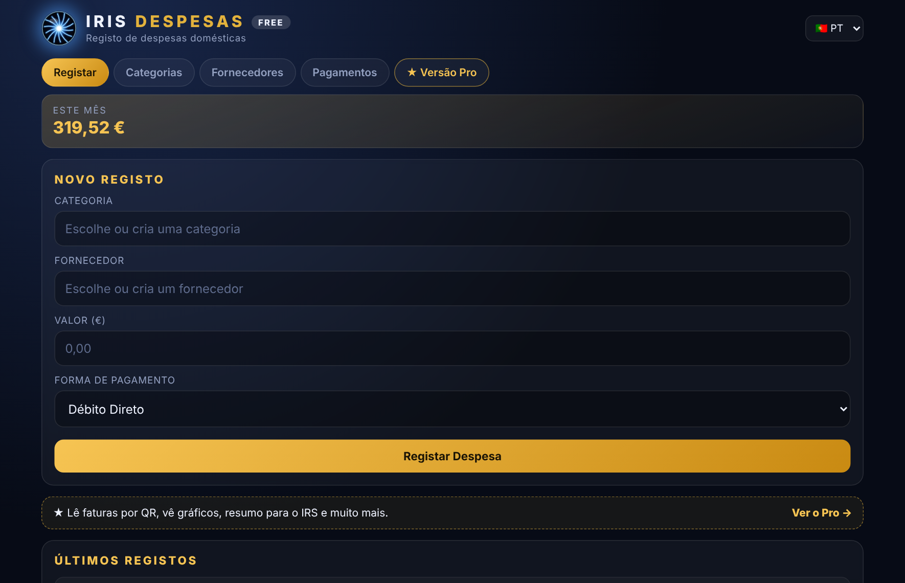
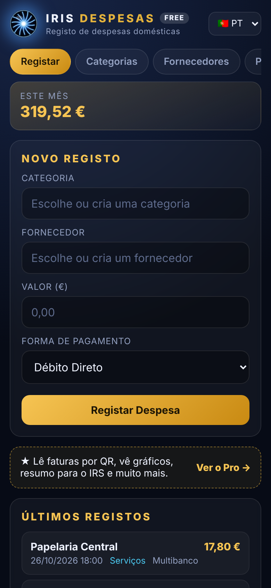
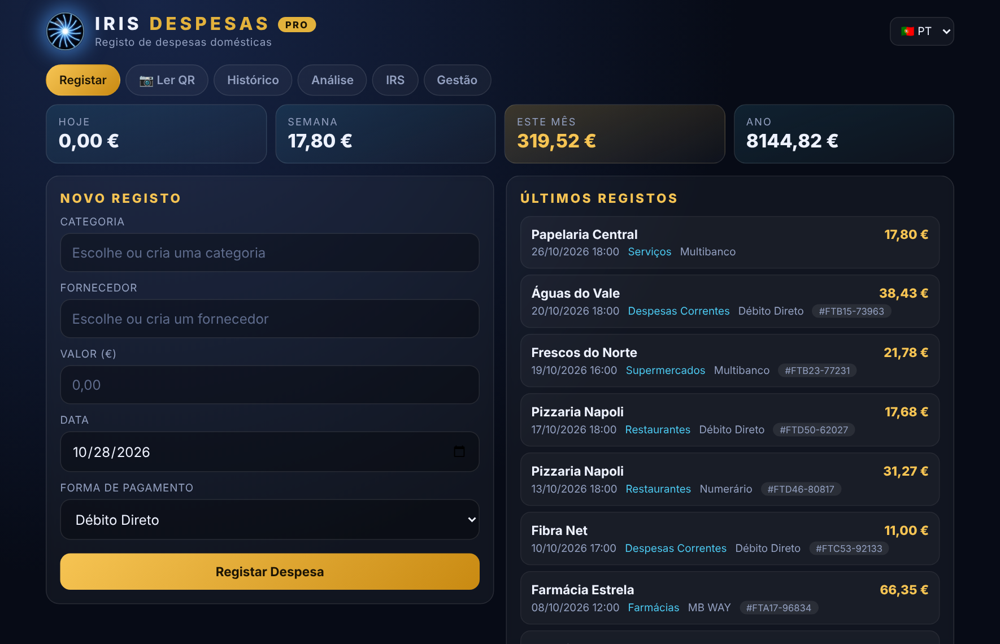
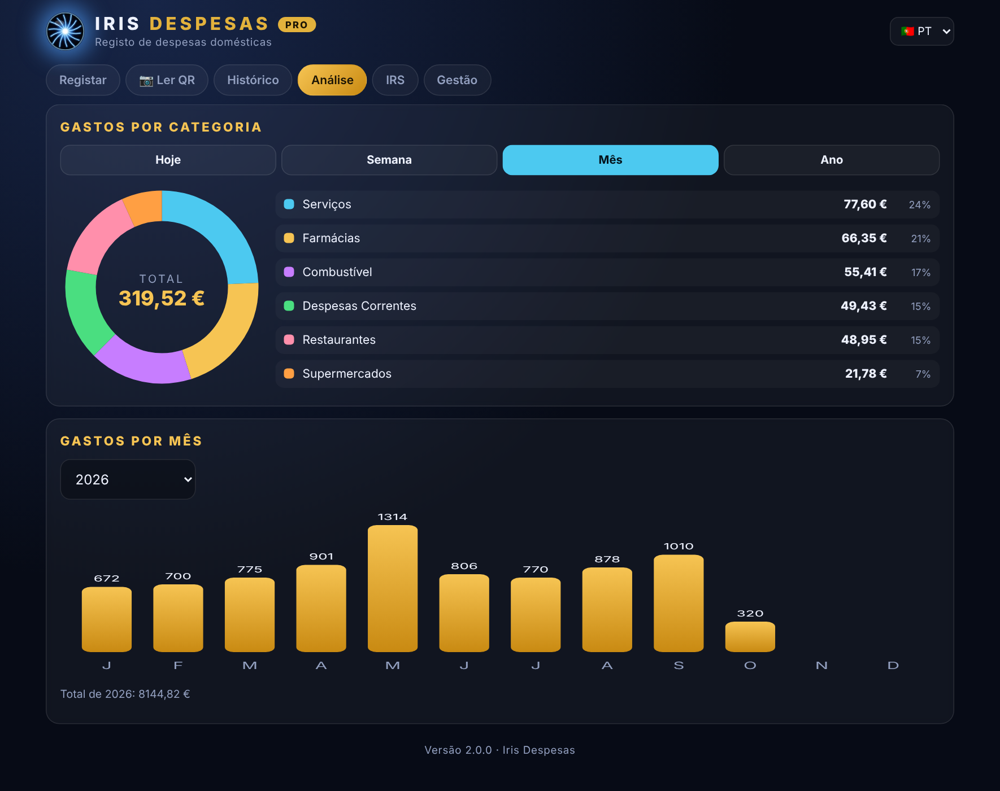
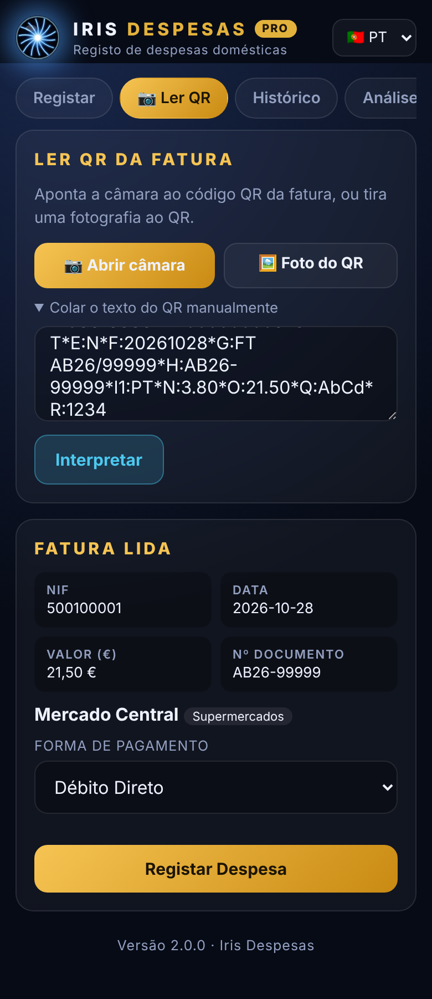
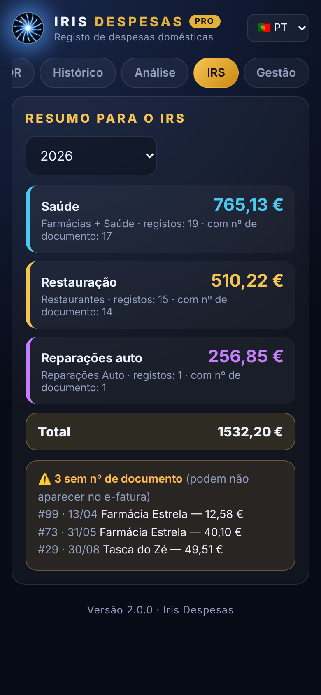
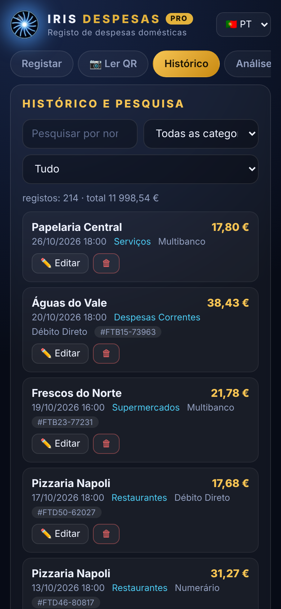

<p align="center">
  
</p>

<p align="center">
  <a href="https://github.com/Hollywoodchaos/despesas-addon/releases"></a>
  
  
  
</p>

<h3 align="center">🧾 Track your household expenses — right inside Home Assistant</h3>

<p align="center">Category → supplier → amount → payment method. Simple, private and 100% local: your data never leaves your Home Assistant.</p>

---

## 📸 Screenshots

<p align="center">
  
</p>

<p align="center">
  
</p>

## ✨ What you get (Free)

| | |
|---|---|
| ➕ **Quick entry** | Pick a category and supplier, type the amount, choose how you paid |
| 🗂️ **Categories** | Ready-made categories (groceries, pharmacy, fuel, health, restaurants…) and your own |
| 🏪 **Suppliers** | Saved per category, with an optional tax ID (NIF) |
| 💳 **Payment methods** | Cash, card, MB WAY, direct debit — and your own |
| 📅 **Recent entries** | The last 15 entries always at hand, plus this month's total |
| 📱 **Responsive** | Looks great on phone, tablet and desktop, inside the Home Assistant sidebar |
| 🗣️ **6 languages** | Português, English, Español, Français, Deutsch, Русский |
| 🔒 **Local & private** | SQLite database stored in the add-on's own folder. No cloud, no account |

## ⚡ Quick start (2 minutes)

1. Press the button above (or follow [Installation](#-installation)) to add the repository, then **Install** and **Start** Iris Despesas.
2. Turn on **Show in sidebar**.
3. Open **Iris Despesas** from the sidebar and record your first expense.

## 🧭 How to record an expense

1. **Category**: pick one (groceries, pharmacy, fuel…) or create your own.
2. **Supplier**: pick one saved under that category, or add a new one (the tax ID, NIF, is optional).
3. **Amount**: type the value.
4. **Payment method**: cash, card, MB WAY, direct debit, or your own.
5. Save. The expense appears under **Recent entries** and the **month total** updates.

**Tips**
- The more you use a supplier, the faster it gets: it is saved under its category.
- Everybody in the house can use it from their own phone, through the Home Assistant app.
- Pick your language inside the app; each person can use a different one.

## 🚀 Installation

<p align="center">
  <a href="https://my.home-assistant.io/redirect/supervisor_add_addon_repository/?repository_url=https%3A%2F%2Fgithub.com%2FHollywoodchaos%2Fdespesas-addon"></a>
</p>

1. In Home Assistant: **Settings → Add-ons → Add-on Store → ⋮ → Repositories**
2. Add `https://github.com/Hollywoodchaos/despesas-addon`
3. Find **Iris Despesas**, click **Install**, then **Start**
4. Turn on **Show in sidebar**

Updating from the old "Despesas" 1.x? Just update — your data is kept.

## ⚙️ Options

```yaml
idioma: pt     # pt | en | es | fr | de | ru  (default language; each person can switch in the app)
```

---

## 💎 Want more? Meet **Iris Despesas Pro**

The Free edition is a complete, ready-to-use expense tracker. **Iris Despesas Pro** turns it into a full household finance hub — and it keeps both editions alive.

<p align="center">
  
</p>

| | Free | Pro |
|---|:---:|:---:|
| Quick entry, categories, suppliers, payment methods | ✅ | ✅ |
| Monthly total + last 15 entries | ✅ | ✅ |
| 6 languages, responsive, 100% local | ✅ | ✅ |
| **Scan invoices by camera** (Portuguese QR code: tax ID, date, amount and document no. filled in for you) | – | ✅ |
| **Duplicate protection** (the same invoice can never be recorded twice) | – | ✅ |
| **Charts** by category (today / week / month / year) and spending by month | – | ✅ |
| **Tax summary (IRS)**: health, restaurants and car repairs per year, with a warning for entries missing a document number | – | ✅ |
| **Full history** with search by name, tax ID or document number | – | ✅ |
| **Edit and delete** entries, rename categories and suppliers (optional admin PIN) | – | ✅ |
| **Export to Excel / CSV** | – | ✅ |

<p align="center">
  
</p>

<table align="center">
  <tr>
    <td align="center"><br><sub><b>Scan the invoice QR</b></sub></td>
    <td align="center"><br><sub><b>Tax summary</b></sub></td>
    <td align="center"><br><sub><b>History & search</b></sub></td>
  </tr>
</table>

<p align="center">
  <a href="https://ko-fi.com/s/fadc8f11ba"></a>
</p>

> **Launch offer:** Iris Despesas Pro is available at a special launch price on Ko-fi for a limited time. One payment, personal-use license, updates included.
>
> *(All screenshots use made-up example data.)*

---

## 🛠️ Troubleshooting

- **The add-on does not show up in the store**: after adding the repository, open the Add-on Store, press **⋮ → Check for updates** and reload the page.
- **I installed Pro from the Ko-fi package and it is not listed**: Pro is a *local add-on*. Copy the `despesas_pro` folder to the **addons** share (Samba share add-on), then **⋮ → Check for updates** and look under **Local add-ons**.
- **The camera does not open (Pro)**: camera access needs a secure HTTPS connection to Home Assistant. Without HTTPS, use the **QR photo** button, which works everywhere.
- **The entry screen looks old after an update**: refresh the page (Ctrl+F5), or reopen the app.
- **Where is my data?** In `/data/despesas.db` inside the add-on. It is included in Home Assistant backups, so restoring a backup restores your expenses.

## ❓ Questions

**Is anything sent to the cloud?** No. Everything stays inside your Home Assistant.

**Does it cost anything?** The Free edition is free and open source (MIT). **Pro** is a one-time purchase on Ko-fi.

**Can I run Free and Pro together?** Yes. They are separate add-ons with separate data; Pro starts with an empty database.

**Is it tax or accounting advice?** No. It is a personal expense tracker; check your figures before using them in any tax return.

## ℹ️ Notes

- Camera scanning in the Pro edition needs a secure (HTTPS) connection to Home Assistant — a browser rule, not an add-on one. Without HTTPS you can still scan by taking a photo of the QR code.
- This project is not affiliated with Home Assistant, Nabu Casa or the Portuguese Tax Authority. The QR code reading follows the public Portuguese invoice QR specification.
- Expense data is yours: it lives in `/data/despesas.db` inside the add-on and is included in Home Assistant backups.

## 🎨 About the logo

The Iris logo (dark sphere with blue filaments) and the "Iris Despesas" name were created for this project with the help of AI tools. The MIT license covers the code; the name and logo are the project's branding, so please don't reuse them for your own products or to imply endorsement. "Iris", "Iris Despesas" and the Iris eye logo are trademarks of Eletro Solar Basto.

## 🇵🇹 Em português

**Iris Despesas** é um addon do Home Assistant para registares as despesas da casa: categoria → fornecedor → valor → forma de pagamento. Tudo local, sem nuvem e sem contas. A edição **Pro** acrescenta leitura de faturas por QR code, gráficos, resumo para o IRS, histórico com pesquisa, edição/eliminação e exportação para Excel — à venda no [Ko-fi](https://ko-fi.com/s/fadc8f11ba).

## 📄 License

MIT © Hollywoodchaos
